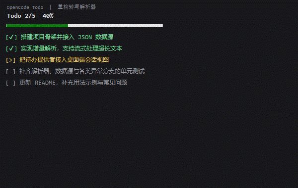

# OpenCode Todo HUD

**English** | [中文](README.zh-CN.md)

[](LICENSE)
[](#requirements)
[](#requirements)
[](#notes--compatibility)

> ⭐ 献给每个使用 opencode 的朋友，如果喜欢可以点个 star，谢谢您！
>
> ⭐ To every friend using OpenCode — if you like it, please give it a star. Thank you!

A desktop widget that stays **attached above the OpenCode window** and shows the
**live todo list and progress** of the [OpenCode](https://opencode.ai) desktop app
— for the session/tab you are currently looking at.



## Features

- **Attached to the OpenCode window** (not to the whole desktop): it stays above
  OpenCode, goes behind any other app you switch to, hides when OpenCode is
  minimised, and closes when OpenCode closes.
- **Borderless** window with no taskbar button; drag the header row to move,
  drag any edge or corner to resize.
- **Follows the active tab** — switch sessions in OpenCode and the HUD follows
  within ~0.3 s.
- Shows `Todo done/total`, a progress bar, and every item:
  - `[✔]` green — completed
  - `[>]` amber — in progress
  - `[ ]` grey — pending
- **The text scales with the window.** Long steps wrap instead of overflowing,
  and the font size is fitted to the frame: make the window wider/taller and the
  text grows to fill it; a long list shrinks it. Every step stays visible — no
  horizontal scrolling, and no vertical scrollbar unless the window is too small
  for the list even at the smallest readable size (then it scrolls at a readable
  size instead of hiding steps).
- **The step text is selectable**: click and drag to select, `Ctrl+C` to copy,
  or right-click → *Copy selected* / *Select all*.
- Remembers its size and position between runs.
- **Read-only and fully offline**: no network access, and it never writes to
  OpenCode's data.

## Requirements

| | |
|---|---|
| OS | Windows 10 / 11 |
| [Node.js](https://nodejs.org) | 18 or newer (uses the built-in `node:sqlite`) |
| PowerShell | Windows PowerShell 5.1 (built in) **or** PowerShell 7+ (`pwsh`) |
| OpenCode Desktop | tested with **2.0.31** |
| Plugin | [`opencode-todolist`](https://www.npmjs.com/package/opencode-todolist) |

> **Why is the plugin required?** OpenCode V2 no longer ships a `todowrite` tool.
> The `opencode-todolist` plugin provides it (`todowrite` / `todoread`), and that
> is what produces the data this HUD displays. The plugin also adds a TUI
> sidebar, but the desktop GUI has no plugin-panel API — so this HUD is what
> makes the todo list visible in the desktop app.

## Install

1. Install the plugin:
   ```sh
   opencode plugin add opencode-todolist
   ```
2. Download or clone this repo to a permanent location.
3. Double-click **`start.cmd`**. Optionally create a desktop shortcut:
   ```powershell
   powershell -ExecutionPolicy Bypass -File .\install-shortcut.ps1
   ```

## Usage

| Action | How |
|---|---|
| Move | drag the **header row** (title / progress area) |
| Resize | drag any edge or corner (the cursor shows a resize arrow) |
| Select / copy a step | click and drag inside the list, then `Ctrl+C` |
| Copy everything | right-click the list → *Select all* (or `Ctrl+A`, `Ctrl+C`) |
| Refresh / reset size / close | right-click the header or the list |
| Fit text to window | resize the window — text scales automatically |

## How it works

Everything is read-only, from two local SQLite databases:

- **Active tab** — OpenCode Desktop persists its tab state in
  `%APPDATA%\ai.opencode.desktop\drafts.sqlite`, table `state`, key `tabs.recent`.
- **Todo list** — stored in `%USERPROFILE%\.local\share\opencode\opencode.db`,
  table `kv`, under `plugin:<hex("aiev.todolist")>:todos/<sessionID>`.

A small Node poller watches those files and writes a JSON snapshot; the
PowerShell/WinForms window renders it.

## Notes / compatibility

- Windows only — the UI is WinForms driven from PowerShell. It runs on Windows
  PowerShell 5.1 (shipped with Windows) and on PowerShell 7+ (`pwsh`);
  `start.cmd` uses `pwsh` when it is installed and falls back to the built-in
  5.1 otherwise, so nothing extra has to be installed.
- The database layouts above are **internal** to OpenCode Desktop and may change
  between versions. Verified against OpenCode Desktop **2.0.31**; if a future
  release moves them, the HUD will simply show *no todo list here*.
- The HUD attaches to the OpenCode main window — the top-level
  `Chrome_WidgetWin_1` window of a process whose name starts with `opencode` — as
  an *owned* window. If OpenCode is not running yet it simply waits; when OpenCode
  closes, the HUD closes with it.
- Non-ASCII todo text is fully supported (read back as UTF-8).

## Credits

- [`opencode-todolist`](https://github.com/aiev/opencode-todolist) by [@aiev](https://github.com/aiev) — the plugin that provides the todo tools this HUD reads (`todowrite` / `todoread`).

## License

[MIT](LICENSE)
